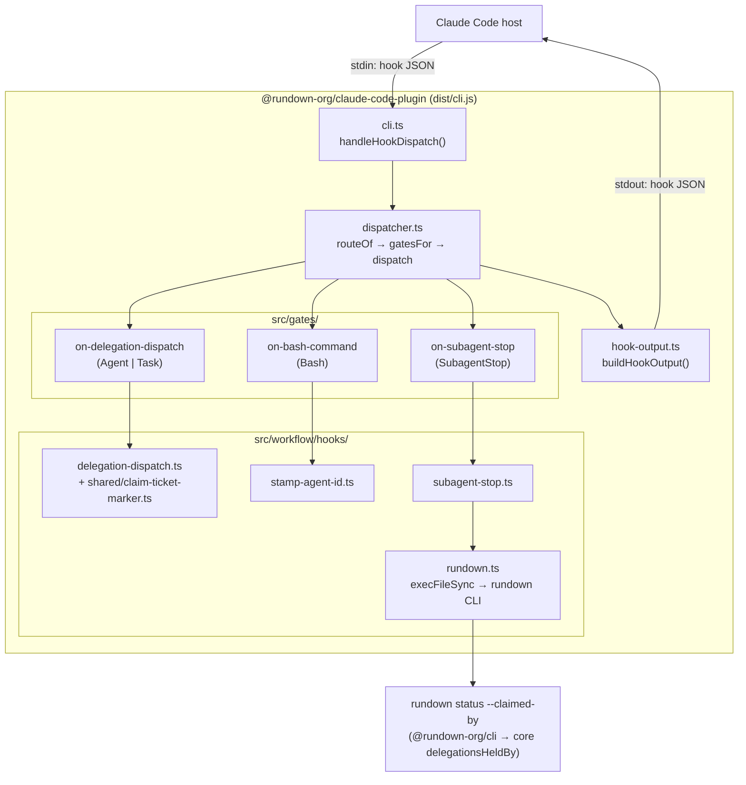
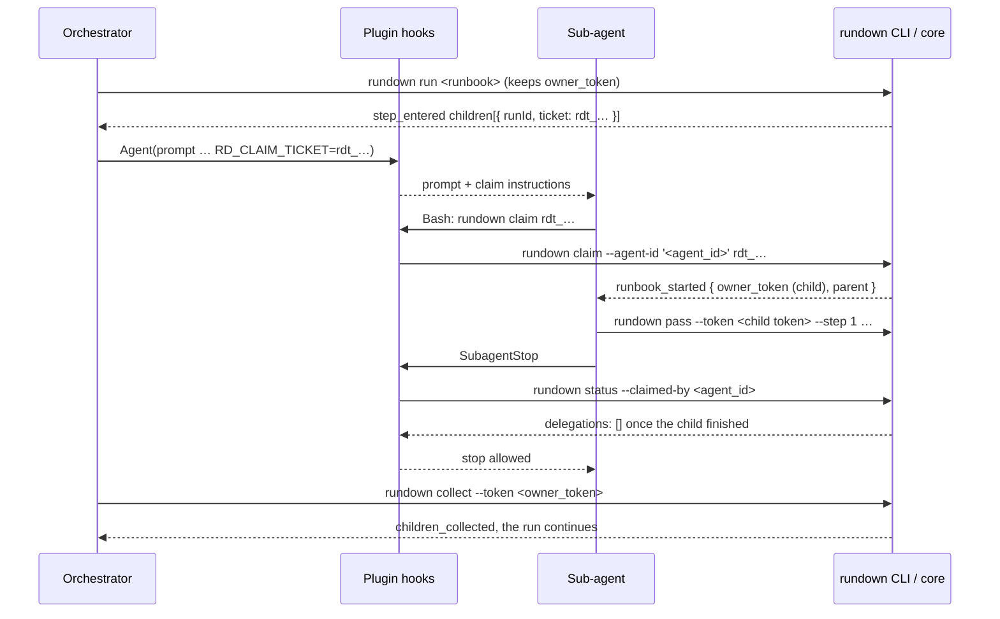

# Claude Code Plugin Overview

Developer-facing reference for `@rundown-org/claude-code-plugin`: what the
plugin's hooks do today, and where each piece lives. Descriptive documentation
of the current code, for engineers new to the plugin.

> **Where the logic lives.** The plugin is a **thin front end** to
> `@rundown-org/core`. Every delegation rule — who may claim, who may release,
> which children still hold a sub-agent — is decided by core and reached through
> the `rundown` CLI. The plugin parses hook payloads, rewrites or refuses tool
> calls, and relays core's answers. See the root
> [`CLAUDE.md`](../../../CLAUDE.md) architectural principles and
> [ADR 0005](../../../docs/adr/0005-one-writer-per-run.md).

---

## 1. Architecture

The plugin is a single Node entry point (`dist/cli.js`) registered against two
native Claude Code hook events. It reads a hook payload on **stdin**, routes it
to one fixed gate, and writes a hook-response JSON object on **stdout**. There
is no repository-level gate config, no generic gate engine, no context files,
and no plugin state: the routing table is fixed in code and the hooks record
nothing.

### 1.1 The entry point — `src/cli.ts`

Drain stdin, `parseHookInput` (Zod), `dispatch`, `buildHookOutput`, print the
output when non-empty. An empty, malformed or failing payload fails **closed**:
stderr plus exit code 2, the universal blocking channel of the hook protocol
(`hook-refusal.ts`).

### 1.2 The router — `src/dispatcher.ts`

| Route                     | Gate                           |
| ------------------------- | ------------------------------ |
| `PreToolUse(Agent\|Task)` | `onDelegationDispatch.execute` |
| `PreToolUse(Bash)`        | `onBashCommand.execute`        |
| `SubagentStop`            | `onSubagentStop.execute`       |

Anything else returns `{}` and emits nothing. A gate's `decision: 'block'`
short-circuits; its `updatedInput` becomes the tool input Claude Code runs; its
`additionalContext` accumulates. A gate that throws is logged and skipped (the
fail-open backstop). No gate reaches it: the SubagentStop gate turns its own
errors into a block first, and the Bash and dispatch decisions are pure
functions of the tool input. The Bash gate is imported statically and loads no
part of `@rundown-org/core`; the dispatch and SubagentStop gates are imported
lazily on their routes, so a Bash call never loads core.

### 1.3 The gates and handlers

- **Delegation dispatch** (`gates/on-delegation-dispatch.ts`,
  `workflow/hooks/delegation-dispatch.ts`). Looks for the Claim Ticket marker —
  `RD_CLAIM_TICKET=rdt_…` on a line of its own, defined once in
  `shared/claim-ticket-marker.ts` — in the Agent/Task prompt and description.
  One ticket: the dispatch proceeds with the claim instructions appended to the
  sub-agent's prompt through `updatedInput` (a PreToolUse `additionalContext`
  reaches the caller, not the spawned agent). Two tickets, a marker that is not
  a ticket, or any other line naming `RD_CLAIM_TICKET` (inline code, trailing
  text, mid-sentence): blocked. Any line ending, CRLF included, ends a marker.
  No marker: untouched. The handler returns a typed decision (`untouched` /
  `claim` / `blocked`) and has no error path.
- **Bash command** (`gates/on-bash-command.ts`,
  `workflow/hooks/stamp-agent-id.ts`, `workflow/hooks/shell-command.ts`). A
  small reader finds each `rundown claim` / `rundown release` it can name with
  confidence (also its short rd bin, `npx @rundown-org/cli`,
  `node …cli/dist/cli.js`, in `&&` / `;` / `|` chains, behind `VAR=x`, `env`,
  `timeout N`, `nice`, `npx`, `pnpm exec`). It removes any `--agent-id` the
  agent typed and inserts `--agent-id '<agent_id>'` right after the subcommand.
  Without an `agent_id` (the top-level agent), such a `claim` is denied
  (`CLAIM_OUTSIDE_SUBAGENT`) and such a `release` is only stripped. Every other
  command — including one it cannot read: a here-document, command substitution,
  an expansion in command position, `sh -c`, `eval` — passes byte for byte,
  never denied on doubt, so the user's Bash permission rules match it as typed.
  The CLI fails closed on what it misses: `claim` without `--agent-id` under
  `CLAUDECODE=1` is `AGENT_ID_REQUIRED`, and `--agent-id` given twice is
  `INVALID_SYNTAX`. The rewrite carries no `permissionDecision`.
- **Subagent stop** (`gates/on-subagent-stop.ts`,
  `workflow/hooks/subagent-stop.ts`). With an `agent_id`, runs
  `rundown status --claimed-by <agent_id>` in each of `CLAUDE_PROJECT_DIR` (the
  session's project root, which does not follow `cd`) and the hook's `cwd` that
  has a `.rundown/rundown.db`, and blocks with the finish-or-release instruction
  while any Delegation is listed (core's `delegationsHeldBy`: running, claimed
  under that id, still counted by its parent). It keeps no counter and never
  creates the store. Fails closed: a CLI failure blocks.
- **`rundown.ts`** resolves `@rundown-org/cli` with `require.resolve` and runs
  `node <cliPath> <args>` through `execFileSync` with an argv array (no shell).
  `setExecSync` injects a fake in tests.

### 1.4 Hook output — `src/hook-output.ts`

| Dispatch result | PreToolUse output                               | SubagentStop output                    |
| --------------- | ----------------------------------------------- | -------------------------------------- |
| `blockReason`   | `permissionDecision: 'deny'` + reason           | `decision: 'block'` + `reason`         |
| `updatedInput`  | `hookSpecificOutput.updatedInput` (no decision) | —                                      |
| `context`       | `hookSpecificOutput.additionalContext`          | `hookSpecificOutput.additionalContext` |
| nothing         | `{}` (nothing printed)                          | `{}`                                   |

### 1.5 Hook registration — `hooks/hooks.json`

`PreToolUse` with matchers `Agent|Task` and `Bash`, and `SubagentStop` with
`.*`, all running `node "${CLAUDE_PLUGIN_ROOT}/dist/cli.js"`.

### 1.6 Sibling bins — `rdpath` and `rdx`

Minor bins, independent of the hooks: `rdpath` (`src/rdpath.ts`) assembles
artifact paths; `rdx` (`src/rdx.ts`, `rdx-core.ts`, `rdx-validate.ts`) renders
JSON artifacts to Markdown and validates them against the plugin schemas. Reach
for them only when a runbook invokes them.

---

## 2. A delegated step, end to end

If the sub-agent tries to stop while its child is running and counted, the gate
blocks with the finish-or-release instruction; a sub-agent that lost the child's
token runs `rundown release <child run id>`, which the Bash hook stamps with its
agent id, and the parent's `collect` applies the abandoned child as a fail. The
orchestrator recovers a lost ticket, an unclaimed child or a lost child token
with `rundown retry --token <owner_token> --step <substep>`.

---

## Quick file map

| Concern                                 | File                                                                                        |
| --------------------------------------- | ------------------------------------------------------------------------------------------- |
| Entry point (stdin → dispatch → stdout) | `src/cli.ts`, `src/hook-refusal.ts`                                                         |
| Router                                  | `src/dispatcher.ts`                                                                         |
| Hook JSON builder                       | `src/hook-output.ts`                                                                        |
| Gates                                   | `src/gates/on-{delegation-dispatch,bash-command,subagent-stop}.ts`                          |
| Handlers                                | `src/workflow/hooks/{delegation-dispatch,stamp-agent-id,subagent-stop,rundown}.ts`          |
| Claim Ticket marker                     | `src/shared/claim-ticket-marker.ts`                                                         |
| Hook registration                       | `hooks/hooks.json`                                                                          |
| Plugin manifest                         | `.claude-plugin/plugin.json`                                                                |
| Sibling bins                            | `src/rdpath.ts`, `src/rdx.ts` (+ `rdx-core`, `rdx-validate`, `*-schema`, `plan-validators`) |
| Skills                                  | `skills/running-runbooks/SKILL.md`, `skills/delegating-runbooks/SKILL.md`                   |
| Trust model                             | [`docs/internal/plugin-trust-model.md`](../../../docs/internal/plugin-trust-model.md)       |
